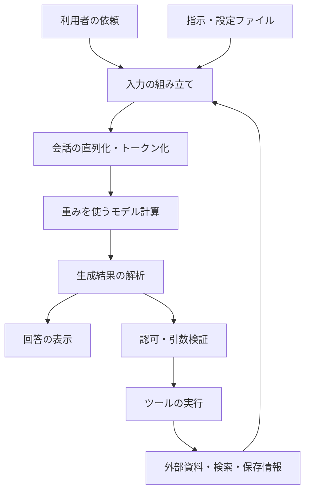

「生成AIがハックされた」「AIを使った情報窃取が起きた」。似た言い方で伝えられるニュースの中に、技術的には異なる出来事が含まれている。

2026-10-22、Forever Securityは、顧客端末のDownloadsフォルダに置かれた不正な `AGENTS.md` を報告した。Codexがその指示に従い、悪意あるパッケージを導入しようとしたという。実環境ではコード実行前に阻止され、ファイルが最初に置かれた経路は未解明だった。[16](#ref-16)

同社は別途、Claude Codeでも実験した。仕込んだ `CLAUDE.md` を通じてAPI接続設定を変更させ、研究者のサーバーへ認証トークンを送らせること、さらにモデル応答を装ったツール呼び出しによるコード実行を報告している。**Claude側は研究者による実証であり、被害企業で確認された同一の侵害ではない。** また、ファイルが存在するだけで実行されるわけではなく、エージェントによる読み込み、信頼の扱い、設定変更や実行の許可条件に依存する。[16](#ref-16)

一方、Anthropicが2026-09に公表した脅威情報報告は、AIを使う攻撃者による情報窃取を扱う。たとえば同社がGTG-20006と呼ぶ活動では、偵察、侵入用ツールの構築・運用、認証情報の取得、盗んだデータの抽出・整理にAIが使われたという。これは防御側のAIが乗っ取られたという話ではなく、**攻撃側がAIを作業・実行の能力として利用した事例**である。[17](#ref-17)

同報告は2025-12から2026-08の選別された事例を扱い、典型例や被害全体の統計ではない。人間が標的を決め、窃取結果を確認していたことも記している。したがって、これだけで「最近の情報漏洩増加はAIが原因だ」「AIが自発的に人間への攻撃を始めた」とは言えない。事例の記述は調査主体の観測・評価であり、本稿による独立した再現・被害確認でもない。[17](#ref-17)

それでも、これらの報告は、AIが人間社会へ重大な危機をもたらすのではないかという問いに接続する。情報の読み書きに加え、認証情報と操作権限を持つAIでは、誤った指示の受け入れが外部の被害へつながりうるからである。ただし、人間による悪用、正当なAIの乗っ取り、自律的な制御喪失、人類規模の破局は、同じ命題ではない。**危機を大きく論じるためにこそ、どの機構と条件が被害を生むのかを細かく切り分ける必要がある。**

モデルが学習した重みか。Transformerの計算処理か。文章をトークンへ変換するtokenizerか。あるいは、チャットアプリのプログラムや、開発者が与える指示なのか。

これらはすべて攻撃対象になりうる。しかし、同じ攻撃ではない。必要なアクセス権限も、効果の持続性も、調査すべき証拠も異なる。

本稿では、主にテキストを扱うTransformer型LLMと、それを組み込んだチャット・エージェントアプリケーションを対象とする。非公開製品の内部実装を推定するのではなく、公開論文と仕様をもとに、攻撃の所在を区別するための構造を示す。

最も重要な問いは、**攻撃者が何を直接変更し、その変更がどの境界を通って結果に達したのか**である。

## 1. Haiouで変えられたのは何か

2026-11-03、Check Point Researchは、Codex向けのHaiouというパッケージについて報告した。分析対象はバージョン4.5.0で、設定・指示ファイルを変更し、Skillsを追加する。安全制約の回避を狙う指示に加え、特定の挨拶への返答にAI中継サービスの広告を挿入する指示が含まれ、広告表示が確認された。[1](#ref-1)

この事例で確認された変更対象は、**ローカルに保存されたエージェントの指示・設定**である。報告は、モデル重み、tokenizer、Transformerの演算実装の変更を示していない。広告挿入が成功したことから、安全制約全体の解除が成功したと結論することもできない。

報告では犯罪者の環境でパッケージが見つかっているが、作者の犯罪関与や、広告されたサービス自体の悪性は裏付けられていない。[1](#ref-1)

したがって、「AIの倫理が書き換えられた」では粒度が粗すぎる。ここでは、モデルの学習結果ではなく、**モデルへ継続的に渡す指示の供給元が変更された**と読むべきである。

この区別を理解するため、まず通常の生成処理を分解する。

## 2. 一回の応答は、モデルだけでは作られない

チャット画面に入力された文章は、通常、そのまま単独でモデルに渡されるわけではない。アプリケーションが、指示、会話履歴、検索結果、保存情報、ツール定義などを組み合わせる。

次の図は、その責任分担を示す模式図である。実際の製品では複数の箱が同じプロセスで実装されることもある。



モデルは、渡された入力から、回答の文章やツール呼び出し候補を生成する。外部サービスを操作するのは、それを受け取ったアプリケーションや実行環境である。ツール結果が新たな文脈として戻り、次の生成が行われることもある。

> **関連解説**：入力の組み立ては[超詳解01「プロンプトは実行時にどうコンパイルされるのか」](https://genai-ron.jp/series/genai-shikumi-deep-dive/01-prompt-compilation/)、責任分担は[超詳解08「全体アーキテクチャ」](https://genai-ron.jp/series/genai-shikumi-deep-dive/08-architecture/)を参照。

この全体を模式的に表すと、次のようになる。

```text
request = Assemble(instructions, user_input, history, retrieved_data, tools)
tokens  = Tokenize(Serialize(request))
logits  = Forward(parameters, tokens)
output  = Decode(logits, generation_settings)
result  = Handle(output, permissions, external_services)
```

logitsは、次の各トークン候補に割り当てられた正規化前のスコアである。典型的にはsoftmaxで確率へ変換し、samplingなどの選択規則で次のトークンを決める。生成済みトークンを入力へ加えながら、この計算を繰り返す。上の表記は、各操作の担当を分けるための擬似コードであり、特定APIの呼び出し例ではない。

「ハック」は、このどこに介入するかによって意味が変わる。

## 3. まず、攻撃対象を一覧にする

以下は標準規格上の階層ではなく、変更対象を見分けるための分類である。特にinstructionは物理的な独立層ではなく、アプリケーションが入力へ配置する情報である。

| 直接変更する対象 | 変更の例 | 主に必要となるアクセス | 主モデルの重み変更 |
|---|---|---|---|
| 入力・外部資料 | 攻撃的な依頼、取得文書への指示混入 | 入力欄、検索対象、ツールの返答などへの影響力 | 通常なし |
| 指示・設定 | developer指示の元データ、読み込まれる指示ファイル | 設定編集、ファイル書き込み、導入パッケージなど | 通常なし |
| 学習データ・評価信号 | 学習例や望ましさの評価を汚染 | 学習・追加学習へのデータ供給経路 | 学習後に変わりうる |
| モデル重み・adapter | checkpointの置換、追加学習、数値編集 | 重みへの書き込み、adapter導入、追加学習権限 | あり、または有効な計算が変化 |
| 推論中の状態 | activation、KV cacheなどへの直接介入 | 推論ランタイムへの内部アクセス | 変更しない方式もある |
| tokenizer・chat template | 語彙対応、正規化、roleの直列化の変更 | モデル配布物・設定・前処理への変更権限 | 必須ではない |
| 推論実装・生成設定 | 演算、logits処理、デコード設定の変更 | 推論サーバーやライブラリの制御 | 必須ではない |
| アプリ・接続先・表示 | 入出力の置換、API中継、認証や画面の改変 | アプリ、拡張機能、接続設定などの制御 | 必須ではない |
| ツール実装・実行権限 | 引数の扱い、送信先、権限確認の変更 | コネクタ、実行環境、認証情報など | 必須ではない |

同じ「拒否しなくなった」という観察でも、原因は複数ある。モデルを交換したのか、指示が変わったのか、応答が中継地点で差し替えられたのかは、表示された文章だけでは判定できない。

また、変更可能であることと、変更が攻撃であることは別だ。正当な追加学習、設定変更、実験も同じ機構を利用する。攻撃という評価には、誰の権限で、誰の目的に反して行われたかが関わる。

## 4. 「ベクトルが変わる」と「重みが変わる」は違う

LLM内部の数値を、すべて「ベクトル」や「重み」と呼ぶと混乱する。少なくとも次の四つを分けたい。

| 数値の種類 | 何を表すか | 典型的な更新の時点 |
|---|---|---|
| 学習済みパラメータ | 埋め込み行列、attentionやMLPの行列など | 学習、重み編集、モデル更新 |
| activation | 入力を処理する途中の内部表現 | 推論中の各層・各位置 |
| attentionの係数 | その入力に対するトークン間の参照の配分 | 推論中 |
| 検索用embedding | 文書などを検索するための外部ベクトル | 文書の登録・再計算 |

### 4.1 重みは、計算に使う学習済みパラメータ

モデルのパラメータ全体を `θ` と書く。これは一つのベクトルに並べて表現することもできるが、実装上は、多数の行列やその他のテンソルとして保持される。

埋め込み行列の行はトークンIDに対応する表現である。attentionの射影行列やMLPの行列は、その表現を変換する。モデルの重みは、単語の意味ベクトルの一覧だけではない。

典型的な固定重みの推論では、入力が変わっても `θ` は更新されない。対話のたびに勾配を計算して重みを更新している、という意味ではない。

> **関連解説**：[詳解版01「LLMの『記憶』はどこにあるのか」](https://genai-ron.jp/series/genai-shikumi-technical/01-memory/)では、モデルのパラメータと外部に保存されたメモリを分けている。

### 4.2 activationは、入力によって変わる途中結果

ある層への入力を `H`、学習済み行列を `W` とすれば、行列積 `HW` の結果は、`W` が一定でも `H` によって変わる。

attentionの一つのheadを簡略化すると、次のようになる。[2](#ref-2)

$$
Q=HW_Q,\quad K=HW_K,\quad V=HW_V
$$

$$
A=\operatorname{softmax}\left(\frac{QK^\top}{\sqrt{d_k}}+M\right),\quad O=AV
$$

ここで `W_Q, W_K, W_V` は学習済み行列、`Q, K, V, A, O` は入力に依存して計算される値である。`d_k` はkeyの次元、`M` は未来の位置などへの参照を制限するmaskを表す。位置情報や複数headの統合などは、この式では省略した。

`A` も「attention weights」と呼ばれるが、学習済みのモデル重みと同じものではない。ここを混同すると、「プロンプトでattentionの重みが変わった」が「モデルを書き換えた」にすり替わる。

攻撃文によって内部表現やattentionの配分が変わったとしても、それはまず**異なる入力に対する計算結果の変化**である。パラメータの変更を意味しない。

さらに、attentionの係数だけから、モデルがある命令に従った理由を完全に説明できるわけでもない。MLP、残差接続、その後の層なども出力に関わる。

### 4.3 ベクトルDBの変更も、LLM重みの変更ではない

RAGの検索インデックスに不正な文書を追加すれば、その文書がモデル入力に入り、回答を変える可能性がある。しかし、ここで変えたのは外部の検索対象である。

文書embeddingと、生成モデルのパラメータを同一視してはいけない。同様に、保存メモリに誤った情報を残し、次の会話で再投入させることも、通常は重みへの学習とは別である。

> **関連解説**：[超詳解03「contextとは何か」](https://genai-ron.jp/series/genai-shikumi-deep-dive/03-context/)／[超詳解06「memoryとは何か」](https://genai-ron.jp/series/genai-shikumi-deep-dive/06-memory/)。

## 5. 倫理・安全性の調整は、どこに存在するのか

「倫理チューニング」という単一の部品があるわけではない。

学習では、望ましい応答例や評価信号を使って、回答・拒否・安全な代替案の出し方を調整する。AnthropicのConstitutional AIは、原則を用いた自己批評と修正、AIによる選好評価を学習へ利用する。OpenAIのdeliberative alignmentは、安全仕様の内容と、それを依頼へ適用する推論を学習させる方式である。[3](#ref-3)[4](#ref-4)

これはパラメータに反映される調整である。一方、運用時にはsystemやdeveloperなどの指示、入出力を判定する分類器、アカウント制御、ツール権限なども関与する。これらは同じものではない。[5](#ref-5)

| 安全性の仕組み | 主な所在 | 変更を見分ける問い |
|---|---|---|
| 安全性に関する学習 | モデルのパラメータ・adapter | どのモデル版を使い、何を追加学習したか |
| 実行時の方針 | 指示文、role、入力の組み立て | どの指示が、どの経路から入ったか |
| 入出力の検査 | 分類器、フィルター、サービス処理 | どの検査がどこで働いたか |
| 操作の制約 | アプリ、実行環境、外部API | その操作を本当に実行できる権限があるか |

「禁止された回答が出た」という一件だけで、これらすべてが突破されたとは言えない。また、拒否の頻度だけで倫理的判断の全体を評価することもできない。正当な依頼への過剰拒否と、危険な依頼への応諾は別に測る必要がある。

## 6. 重みそのものを変更する攻撃

重みを変えるには、重みファイルを交換する、追加学習を実施する、数値を編集する、といった経路が必要になる。通常の入力欄から文章を送る操作とは異なる。

学習データの汚染では、攻撃者が直接モデルのファイルへ書き込まなくても、学習に採用される例や評価信号へ影響を与えられれば、結果のパラメータへ影響しうる。この場合は、侵入口がデータ、持続する変更先がモデルである。

追加学習については、Qiらが2023年、当時のGPT-3.5 TurboとLlama 2系モデルを対象に、安全上の振る舞いが追加学習後に弱まる場合を報告している。善意の用途向けデータでも影響が生じた。この結果は、安全性が追加学習を経ても自動的に保存されるとは限らないことを示すが、現在の全モデルに同じ結果が当てはまるという意味ではない。[6](#ref-6)

adapterにも注意が必要だ。たとえばLoRA型の更新は、基底行列 `W` を固定したまま、低ランクの追加行列によって有効な変換を変える。

$$
W_{\mathrm{effective}} = W + \Delta W
$$

基底モデルのファイルが同じでも、adapterが違えば同じ計算とは限らない。「重みファイルのハッシュが一致する」という確認は、読み込まれるadapterや実行設定まで同一であることを保証しない。[7](#ref-7)

モデルの変更を調査するなら、入力の履歴だけでなく、checkpointの識別子、adapter、学習履歴、読み込み設定を確認する必要がある。

## 7. Transformerの関数や推論中の状態を変更する攻撃

Transformerという語は、attention、MLP、残差接続などを組み合わせた計算構造を指す。実装では、ソフトウェアの処理と、そこに渡す学習済みパラメータが組み合わさる。

このため「Transformerをハックした」には、少なくとも三つの異なる意味がありうる。

| 変更 | 何が起きるか |
|---|---|
| 計算構造・実装の変更 | attention処理、mask、演算ライブラリなどを変更する |
| 内部状態への直接介入 | 特定段階のactivationなどを差し替える |
| 入力による誘導 | 実装と重みを変えず、異なる入力で異なる計算結果を引き出す |

activationを操作する研究の一例として、Arditiらは2024年、対象とした13の公開チャットモデルで、拒否に関わる内部表現の方向を報告した。論文ではactivationへの介入と、関連する重み編集を区別して扱っている。[8](#ref-8)

これは「全モデルの倫理が一本のベクトルに格納されている」という結論ではない。対象モデル・課題・評価条件における、拒否という振る舞いへの介入結果である。

また、推論中の状態を直接変更するには、通常、推論処理への内部アクセスが必要だ。APIへ文章を送れるだけの利用者と、モデルを自分の環境で実行する管理者では、操作できる範囲が違う。

KV cacheも同様である。これは過去のトークンから計算したkey/valueを再利用するための状態であり、モデル重みそのものではない。会話が進むと内容が増えることと、学習済みパラメータが変わることは別である。[9](#ref-9)

さらに、logitsの後処理やsampling設定を変えて出力を変える方法もある。重みを変更せず生成結果へ影響するが、temperatureの変更を「倫理スイッチの解除」と呼ぶのは不正確である。

## 8. tokenizerを攻撃するとは、何をすることか

tokenizerは、文字列などをモデルが処理するトークンIDへ変換する仕組みである。方式によって、正規化、前分割、語彙への対応付け、特殊トークンの追加などを含む。[10](#ref-10)

ここでも、**tokenizerを変更することと、同じtokenizerに別の文字列を入れることを分ける**必要がある。

### 8.1 tokenizerそのものの変更

語彙とIDの対応、分割規則、正規化設定、実装を変更する場合である。変更権限は、モデル配布物や推論環境の管理側に必要となる。

トークンIDは埋め込み行列の対応する行へ接続するため、対応関係を無造作に変更すれば、特定の出力を狙う以前に性能を壊すこともある。tokenizerの差し替えは、意味を自由に指定できる単純な操作ではない。

### 8.2 入力文字列の工夫

表記、区切り、文字の組み合わせなどを変え、同じtokenizerが異なるトークン列を出すようにする場合である。

これはtokenizerの入力への介入であって、その実装の改ざんではない。ある入力で安全判定が失敗しても、原因が分割処理なのか、学習の偏りなのか、別のフィルターとの解釈差なのかは、追加の検証が必要になる。

### 8.3 chat templateの変更

会話の `role` と本文を、モデルが期待する並びや制御トークンへ変換するchat templateも重要である。Hugging Faceの公開実装では、会話をトークン列へ変換する際に、このテンプレートが使われる。[11](#ref-11)

tokenizer設定と一緒に扱われる場合があるが、役割は区別できる。tokenizerは文字列とトークンの対応を担い、chat templateはメッセージの構造を表現する。

不正なテンプレートや不適切な入力結合は、誰の発言かという境界を壊しうる。ただし、本文に `system:` と書けば正式なsystem messageになる、という意味ではない。特殊トークン風の文字列をどう扱うかも実装依存であり、公開実装の挙動をそのまま閉じたサービスへ当てはめられない。

## 9. developer instructionは、別のニューラルネットワーク層ではない

developer instructionは、アプリケーション側の方針を与える入力の区分である。Transformerの第何層かに「developer専用の関数」が独立して置かれている、という意味ではない。

roleの名前や優先規則は製品・APIによって異なり、すべてのLLMに共通する物理法則ではない。アプリケーションやAPIは、メッセージの出所とroleを区別する。モデル側は、その区別を表現した入力に対し、上位指示を優先するよう学習される。指示階層を訓練によって強化する研究も、この問題を扱っている。[12](#ref-12)

ここには、二種類の境界が重なっている。

- **構造上の境界**：アプリケーションが何をdeveloper、user、tool resultとして渡したか。
- **振る舞い上の境界**：モデルがその区分に従って、どの文章を命令として扱ったか。

正式なroleが変わらなくても、モデルが外部資料の指示へ従ってしまうことはありうる。逆に、モデルの判断以前に、アプリケーションが外部の文章をdeveloper指示へ混入させてしまう場合もある。両者の責任箇所は異なる。

> **関連解説**：[超詳解02「指示階層とは何か」](https://genai-ron.jp/series/genai-shikumi-deep-dive/02-instruction-hierarchy/)は、roleの優先順位、ファイルの結合順、製品機能の適用範囲を分けて説明している。

### 9.1 指示の改ざんと、資料からの命令混入

開発者用の指示を保存する設定ファイルを書き換え、次回の起動時に読み込ませるなら、変更対象は指示の供給元である。

一方、要約対象のWebページに攻撃者の命令があり、それをモデルが作業指示として受け取ってしまうなら、変更対象は外部資料である。こちらが間接的なprompt injectionの典型であり、取得データと命令の区別が崩れる問題として研究されている。[13](#ref-13)

文書名が `AGENTS.md` や `SKILL.md` だから、常に同じroleへ入るわけではない。どのアプリが、どの場所から、どの適用範囲で読み込み、どの入力として渡すかを確認する必要がある。CodexのAGENTS.mdの探索・結合にも、製品側の規則がある。[14](#ref-14)

Haiouを「developer instructionのハック」と大まかに呼ぶことはできても、厳密には、対象版が変更するファイルと、その版のloaderが組み立てたrequestを照合しなければ、正確なrole配置までは確定できない。

### 9.2 jailbreakとprompt injectionは、分類軸が違う

本稿では、jailbreakを安全方針に反する応答を引き出す試み、prompt injectionを入力中の指示によって本来の作業や指示の扱いを乗っ取る試みとして区別する。用語の使い方は資料によって重なる。

広告への誘導は、危険行為の支援を出させなくても成立する。逆に、利用者自身が有害な応答を求める場合、他人の文書やセッションを乗っ取る必要はない。

**安全方針を回避したか**と、**正当な依頼者の目的から逸脱させたか**は、別々に調べるべき問いである。

## 10. チャットアプリとツールを攻撃する場合

生成AIを使うアプリも、認証、設定、ネットワーク、データベース、画面表示を持つソフトウェアである。

入力を送る前に改変する、モデルの応答を受け取った後で置換する、接続先を別サービスへ変える、表示部分へ広告を挿入する、といった変更は、主モデルの重みに触れずに可能な構造である。これは一般的なアプリケーション上の攻撃面の整理であり、Haiouがすべてを行ったという主張ではない。

画面に広告が出た場合でも、モデルが広告文を生成したのか、アプリが後付けしたのかで機構が違う。調査には、モデルへ送る前のrequest、受信直後のresponse、表示直前のデータの比較が必要になる。比較用の記録では、認証情報や個人情報をそのまま公開ログへ残さない。

### 10.1 ツールの説明も、実装も、攻撃面になる

ツールには、モデルへ見せる名前・説明・引数schemaと、実際に動く関数がある。MCPの仕様でも、ツールの定義と呼び出し・結果は分かれている。[15](#ref-15)

説明文へ不正な指示を混入させるのは、モデル入力への介入である。説明は正しいまま、実装が別の場所へデータを送るなら、ツール実装の問題である。この二つも混同できない。

### 10.2 tool callは、許可そのものではない

モデルがメール送信用の正しいJSONを生成しても、その送信が利用者の意図に沿うことまでは保証されない。schema検証は、項目や型が合っていることを確認する。送信先への権限、扱う情報の範囲、操作の承認とは別である。

したがって、実装では、候補の生成から実行までの間に認可を置く必要がある。たとえば、読み取り専用のcredentialしか渡されていなければ、モデルが書き込みを提案しても、そのcredentialでの書き込みは成立しない。

自然言語で「送信しない」と指示することと、送信できる権限を与えないことは、異なる制御である。

> **関連解説**：[超詳解04「ツール実行ループとは何か」](https://genai-ron.jp/series/genai-shikumi-deep-dive/04-tool-execution-loop/)／[超詳解05「構造化出力とは何か」](https://genai-ron.jp/series/genai-shikumi-deep-dive/05-structured-output/)／[超詳解07「停止条件と検証ループ」](https://genai-ron.jp/series/genai-shikumi-deep-dive/07-agentic-loop/)。

## 11. 持続するからといって、学習されたとは限らない

翌日も同じ誘導が残ると、「モデルが覚えた」と感じやすい。しかし、持続性を作る場所は複数ある。

| 持続の場所 | なぜ再発するのか | 確認対象 |
|---|---|---|
| 会話履歴 | 攻撃文やその影響を受けた応答が再投入される | 実際に送った履歴・要約 |
| 保存メモリ・検索対象 | 誤った記録や文書が再取得される | 保存レコード、取得結果、出所 |
| 指示ファイル・設定 | 起動やrequestごとに同じ指示を読み込む | ファイル差分、loader、設定 |
| 重み・adapter | 変更されたモデルで推論し続ける | checkpoint、adapter、モデル版 |
| アプリ・中継・ツール | 同じ改変処理が毎回実行される | 配布物、接続先、実行ログ |

設定ファイルまで変更された場合、会話を閉じたり元の不正文書を削除したりするだけでは、変更済みの接続先や起動処理は戻らない。影響範囲に応じて、設定の復元や流出した認証情報の失効も必要になる。

この表から分かるのは、**永続化とパラメータ学習は別の概念**だということである。

新しいチャットにして直るか、同じモデルを別アプリから呼ぶとどうなるか、同じアプリでモデルを変更するとどうなるか。こうした比較は原因候補を狭める。ただし、履歴や接続設定も同時に変わる場合があるため、一つの比較だけで原因を断定してはいけない。

## 12. 「AIがハックされた」を技術的な説明に直す

報道や実験を読むときは、次の順で確認すると、対象が明確になる。

1. **入口**：攻撃者は何に触れられたか。入力、文書、設定、重み、アプリ、ツールのどれか。
2. **直接の変更**：具体的に何が書き換わったか。入力内容の変化と、プログラムやパラメータの変更を分ける。
3. **通過した境界**：資料が命令として扱われたのか、出力が操作として実行されたのか。
4. **観測された結果**：回答が変わったのか、外部状態まで変わったのか。
5. **持続の場所**：会話、保存情報、設定、モデル、アプリのどこに残るのか。
6. **証拠の範囲**：確認済みの現象と、可能性として述べられた影響を分ける。

この枠組みでHaiouを読むと、直接の変更対象はエージェントの指示・設定であり、その後のモデル入力と応答へ影響する。重みやTransformerの演算を直接変更した事例として扱うべきではない。

また、どの層が改ざんされたかと、被害の大きさは同じ軸ではない。入力だけの変更でも、強いツール権限へ接続すれば重大な結果を生みうる。反対に、内部表現への研究上の介入が、それだけで外部サービスへの侵入を意味するわけでもない。

生成AIの安全性は、モデルがどんな文章を生成するかに加え、何を入力し、誰の指示として扱い、何を実行できるようにするかに依存する。技術的に「何がハックされたか」を説明するとは、この変更対象と権限の経路を具体的に示すことである。

### 12.1 社会的な危機へ接続するときに、追加で問うこと

| 論じたい問題 | 追加で必要な証拠 |
|---|---|
| 人間がAIを使って攻撃能力を増す | AIが担った工程、人間の判断、AIを使わない場合との速度・規模・成功率の比較 |
| 正当なエージェントが乗っ取られる | 不正入力の出所、読み込み条件、誤って信頼された箇所、実行された操作 |
| AIが指示者の意図から自律的に逸脱する | 目的・制約・権限の記録、逸脱が生じる条件、停止・訂正への応答、再現性 |
| 被害が人類規模へ拡大する | 個別侵害から大規模被害に至る因果経路、必要能力、接続先・資源、封じ込めの失敗条件 |

この表は危機を小さく見積もるためのものではない。一件の情報窃取は重大でありうるが、それだけで人類規模の破局まで実証したことにはならない。一方、モデル重みが無傷であることも、被害が軽微である根拠にはならない。モデル、アプリケーション、権限、社会的な接続先を分けることで、何が既に観測され、何が条件付きの将来リスクなのかを議論できる。

## 注釈と参考資料

参照確認日：2026-11-08。サイト内リンクは技術概念を補う解説、以下は外部の一次資料である。実験結果は各論文の対象・条件に限って読む。

1. <a id="ref-1"></a>Check Point Research, 2026-11-03, [Free the Model, Sell the Gateway: Prompt Adware hidden in Jailbreak Bundles](https://research.checkpoint.com/2026/free-the-model-sell-the-gateway-prompt-adware-hidden-in-jailbreak-bundles/). Haiouの分析対象、変更される指示、広告挿入、帰属に関する留保。一次調査報告であり、本稿による再現実験ではない。
2. <a id="ref-2"></a>Vaswani et al., 2017, [Attention Is All You Need](https://arxiv.org/abs/1706.03762). 特に§3.2のattentionと§3.3のfeed-forward network。原論文のencoder-decoder全体と、現在のdecoder-only LLMは同一構成ではない。
3. <a id="ref-3"></a>Bai et al., 2022, [Constitutional AI: Harmlessness from AI Feedback](https://www.anthropic.com/research/constitutional-ai-harmlessness-from-ai-feedback). 原則を用いた修正とAI評価による学習。
4. <a id="ref-4"></a>OpenAI, 2024-12-20, [Deliberative alignment: reasoning enables safer language models](https://openai.com/index/deliberative-alignment/). 安全仕様とその適用を学習する手法。
5. <a id="ref-5"></a>Anthropic, 2025-08-12, [Building safeguards for Claude](https://www.anthropic.com/news/building-safeguards-for-claude). 学習、指示、分類器、利用制限を含む多層の対策。
6. <a id="ref-6"></a>Qi et al., 2023, [Fine-tuning Aligned Language Models Compromises Safety, Even When Users Do Not Intend To!](https://arxiv.org/abs/2310.03693). 追加学習に伴う安全性低下。本文ではabstractに記された実験対象と結論の範囲を用いた。
7. <a id="ref-7"></a>Hu et al., 2021, [LoRA: Low-Rank Adaptation of Large Language Models](https://arxiv.org/abs/2106.09685). 基底の重みを固定した低ランクの適応。
8. <a id="ref-8"></a>Arditi et al., 2024, [Refusal in Language Models Is Mediated by a Single Direction](https://arxiv.org/abs/2406.11717). §2〜4で内部表現への介入と重み編集を区別。拒否の研究を、倫理全体の局在と同一視しない。
9. <a id="ref-9"></a>Hugging Face, [Caching](https://huggingface.co/docs/transformers/cache_explanation). 推論時にkey/valueを再利用する仕組み。
10. <a id="ref-10"></a>Hugging Face, [The tokenization pipeline](https://huggingface.co/docs/tokenizers/pipeline). 正規化、前分割、tokenization model、後処理の区別。
11. <a id="ref-11"></a>Hugging Face, [Chat templates](https://huggingface.co/docs/transformers/chat_templating). roleとcontentからモデル固有の会話形式を構築する処理。
12. <a id="ref-12"></a>Wallace et al., 2024, [The Instruction Hierarchy: Training LLMs to Prioritize Privileged Instructions](https://arxiv.org/abs/2404.13208). 指示の優先順位を学習する研究。本文はabstractに記された目的・方法の範囲を用いた。
13. <a id="ref-13"></a>Greshake et al., 2023, [Not what you've signed up for: Compromising Real-World LLM-Integrated Applications with Indirect Prompt Injection](https://arxiv.org/abs/2302.12173). 取得データを経由する間接的な指示混入。本文はabstractに記された概念の範囲を用いた。
14. <a id="ref-14"></a>OpenAI, [Custom instructions with AGENTS.md](https://developers.openai.com/codex/guides/agents-md). 指示ファイルの探索・適用。製品のloader規則とAPI上のroleを区別する。
15. <a id="ref-15"></a>Model Context Protocol, [Tools — specification 2025-06-18](https://modelcontextprotocol.io/specification/2025-06-18/server/tools). ツール定義、呼び出し、結果、安全上の考慮事項。版を固定して参照。

16. <a id="ref-16"></a>Gal Weizman and Omer Samet / Forever Security, 2026-10-22, [Markdown Is the New Executable: Attackers Are Dropping Agent Instructions Into Your Downloads Folder From the Web](https://forever.security/blog/hijacking-ai-agents-via-downloads-folder). 「It all started with an alert」と「2. Claude」を区別。実端末での発見と研究者の実証、投入経路不明、対象環境の条件を切り分けて参照。
17. <a id="ref-17"></a>Anthropic, 2026-09, [Detecting and countering misuse of AI: September 2026](https://www.anthropic.com/threat-intelligence-report-september-2026). Introduction、Cyber operationsのTrendsとGTG-20006。提供事業者による選別された活動報告であり、全情報漏洩に対するAI利用率や因果寄与の統計ではない。

## 更新履歴

- 2026-11-08 15:38 JST：Downloads経由の指示混入とAIによる情報窃取を導入へ追加。実観測・実証・将来リスクを区別し、指示階層と設定の永続化を再レビュー。

- 2026-11-08 14:58 JST：一次資料との照合、注釈への文中リンク、logitsと生成処理の説明を補完。
- 2026-11-08 14:53 JST：記事初稿を作成。変更対象、アクセス権限、持続性による分類と、超詳解版への関連リンクを追加。
